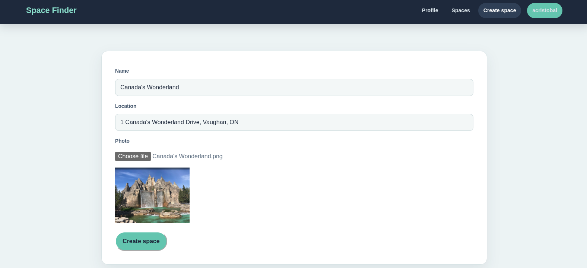
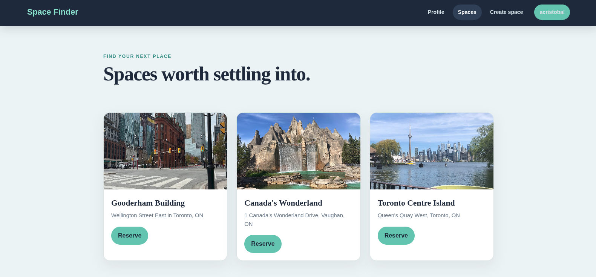

# Space Finder

A full-stack serverless application built with AWS and TypeScript, organized as a pnpm monorepo.

## Overview

Space Finder helps users discover and reserve shared spaces with a modern serverless architecture, a React frontend, and AWS-managed infrastructure.

<div align="center">
  <p><strong>Create a space with location details and an optional photo upload.</strong></p>
  
</div>

<div align="center">
  <p><strong>Browse available spaces and reserve one from the application.</strong></p>
  
</div>

<div align="center">
  <p><strong>AWS deployment pipeline for automating infrastructure and application delivery.</strong></p>
  
</div>

## Architecture

- **Backend (apps/api)** — AWS CDK app that provisions and manages all cloud infrastructure
- **Frontend (apps/ui)** — React + Vite SPA that interacts with the backend APIs
- **packages/cdk-outputs** — Shared CDK deployment outputs consumed by the frontend

## Tech Stack

**Infrastructure**

- AWS CDK + CloudFormation
- Amazon Cognito (User Pools + Identity Pools)
- Amazon API Gateway + AWS Lambda
- Amazon DynamoDB
- Amazon S3

**Frontend**

- React 18 + TypeScript
- Vite
- AWS Amplify (auth)
- AWS SDK v3

**Monorepo**

- pnpm workspaces
- Turborepo
- GitHub Actions CI/CD

## Project Structure

```text
apps/
  api/        # CDK infrastructure + Lambda handlers
  ui/         # React frontend
packages/
  cdk-outputs/        # Shared CDK stack outputs
  eslint-config/      # Shared ESLint config
  typescript-config/  # Shared TypeScript config
```

## Getting Started

**Prerequisites:** Node.js, pnpm, AWS CLI configured

```bash
# Install dependencies
pnpm install

# Deploy infrastructure and generate outputs
pnpm --filter space-finder-api deploy

# Start frontend dev server
pnpm --filter space-finder-ui dev

# Build all
pnpm build

# Run tests
pnpm test
```

## Environment Variables

Create `apps/api/.env` based on the following:

```env
AWS_REGION=
USER_POOL_ID=
USER_POOL_CLIENT_ID=
IDENTITY_POOL_ID=
TEST_USERNAME=
TEST_PASSWORD=
SLACK_WEBHOOK_URL=
```

